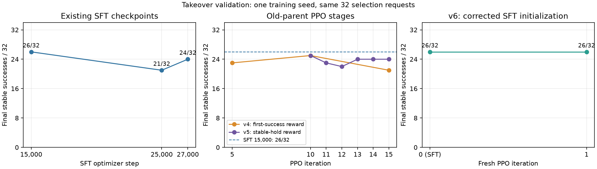

EmbodiChain Stack Cube experiment evidence
==========================================

Inspect the measured seed 0 SFT-to-PPO comparisons and their runtime identities before using these results to assess the example. The files contain metrics, inputs and checksums; model weights, demonstration videos and policy videos are not included.

``summary.json`` records the task metric, pinned sources, hardware, training settings, actual checkpoint optimizer counts and release status. ``custom_native_paired_episodes.csv`` and ``public_pinned_paired_episodes.csv`` retain the original 27 development cases, including gains and losses. ``public_training_scalars.csv`` contains the first 50 epochs only; evaluation scalars use the continuing rollout RNG and are monitoring results rather than cold comparisons. ``iteration_ledger.csv`` preserves earlier successful and failed stages with their scope.

``validation_requests.json``, ``training_requests.json`` and ``norm_stats.json`` are exact measured inputs. The statistics belong to the measured 120-episode V2 training dataset; they must not be applied to an unrelated dataset. V2 uses 64 train-world and 56 eval-world renderer roles, with training requests in both roles. Its exact dataset and selected SFT/PPO checkpoints were retained by the original author and have no public download URLs; they are unavailable in the takeover checkout. The provided fresh expert collector does not reproduce V2's production-renderer images.

``experiment_source_sha256.json`` describes the frozen source used by the public 50-epoch run. Subsequent documentation, API annotations, task cleanup and RewardManager migration are outside that snapshot. Every file in this bundle is listed in ``SHA256SUMS``; run ``sha256sum -c SHA256SUMS`` from this directory to verify them. These one-seed development results do not establish independent test/OOD performance or multi-seed stability.

``validation.json`` records the PR worktree CPU regression coverage, selected pytest node IDs, documentation checks and the reviewed installation-check advisory. Run the listed nodes with the model interpreter, then the SDK-dependent nodes with the simulator interpreter and ``CUDA_VISIBLE_DEVICES=""``. The PR description records the final pre-commit and DCO status.

``reward_manager_parity.json`` compares the adapter before migration with the configured SDK RewardManager on 14 scripted CPU traces, covering 74,700 scalar rewards, existing observation/done/episode fields and reset behavior. It records the source and configuration hashes. These checks use scripted scene measurements and do not constitute a new physics rollout or PPO training result.

``native_reward_parity.json`` records the subsequent move to EmbodiChain's native step and SDK ``success_reward``. It compares the preceding commit ``012398dd`` with the native pipeline on the same 14 scripted traces and 74,700 scalar rewards. Existing transition fields, reset behavior and repeated info reads match exactly at that recorded snapshot, which passed 41 focused CPU cases. These checks use the unchanged pinned SDK and scripted physics; measured training results retain their original source snapshot.

``isaaclab_reward_alignment.json`` validates the native Gym configuration in ``env.yaml`` and the ``stack_cube_protocol`` episode selector. It records 39 passing CPU cases, eight GPU expert replays of 380 steps each with stable completion, and exact agreement with the pinned IsaacLab source on 3,040 measured rewards plus 1,055 boundary samples. Both protocols expose the native reward term as ``info["rewards"]["success"]``. The IsaacLab check uses unchanged manager and predicate source with lightweight configuration and scene objects; the full runtime launch stopped at its pending NVIDIA EULA prompt. The report includes source and trace hashes and the local audit directory. These are contract and replay checks, with no optimizer updates.

The workflow adds task-wrapper registration, a separate deterministic inference crop, and public reward fixtures under ``tests/fixtures/embodichain_stack_cube/``. Run ``toolkits/lerobot/compare_stack_cube_rewards.py`` to repeat the pinned-source comparison; fixture provenance and the command are documented beside the samples. Historical training figures above retain their recorded source snapshot. The current draft wires separate public-input PPO and SFT/resume CI jobs; remote execution and public release of the V2 dataset and learned weights remain pending.

``takeover_validation.json`` records the checks rerun for the main-branch update on 2026-10-24. It covers the fresh uv installation, public-video audit, two-rank SFT save/resume, native expert collection and action replay, and a short public-input PPO run. These checks validate pipeline execution and checkpoint behavior; the original author's policy-quality measurements above retain their recorded source snapshot.

Takeover Quality Measurements
-----------------------------

Use ``takeover_quality.json`` and ``takeover_quality_curve.csv`` to inspect the
new seed-0 comparison on 32 fixed validation requests. Each learned-policy run
executes 450 physical control steps with batch size 8, H10/C5 and 10 denoising
steps. Final success requires released fingers and 20 consecutive stable steps.
The physical audit recomputes geometry and speeds and checks executed commands
against saved predictions. All candidates use the corrected export loader.

SFT steps 15,000, 25,000 and 27,000 achieve 26/32, 21/32 and 24/32 final stable
successes. The selected checkpoint remains step 15,000; its learning-rate
schedule was configured for 30,000 steps. The late checkpoints were evaluated
from existing files with no additional SFT training.

PPO v4 iterations 5, 10 and 15 achieve 23/32, 25/32 and 21/32. The next fixed
stage resumes iteration 10 with a stable-hold reward and 128 parallel scenes;
iterations 11 through 15 achieve 23/32, 22/32, 24/32, 24/32 and 24/32. These
results have not demonstrated PPO improvement over the selected SFT model.
Several settings changed together, so the comparison does not isolate a cause.
The old PPO parent already contains rounded values in 40 frozen FP32 tensors;
their effect on task quality has not been established.

   Final stable successes on the same validation cohort. PPO v5 starts from
   v4 iteration 10; PPO v6 starts a new counter from the corrected SFT policy.

The new demonstrations contain 256 episodes and 97,280 frames. Their cohort,
normalization and evaluator hashes differ from the original 27-request study;
keep these measurements separate from the historical results. The 32 requests
were reused for selection, only one training seed was evaluated, and the final
100-request test remains unused. Full checkpoints, demonstrations, trajectories,
the batched experiment evaluator and logs remain in the local handoff. The
report records their identities; it does not provide a public model release.

A fresh PPO stage started directly from the corrected SFT step-15,000 deployment.
Its two actor and rollout ranks match the SFT policy fingerprint exactly; a
64-row replay has zero ratio/value error before any optimizer update. This
initial check covers critic gradients during warmup. The stage stopped after
one complete iteration: both ranks recorded 270 optimizer updates, including
45 critic-only warmup updates; the replacement optimizer contains 198 states
at Adam step 225. The export has 190 changed policy tensors, 477 unchanged
frozen tensors and 675 finite tensors with their original dtypes. Its checkpoint
achieves 26/32 stable successes, with two gains and two regressions relative to
SFT. Training and validation have finished; the selected model remains SFT
step 15,000 because PPO has not improved the measured success count.
